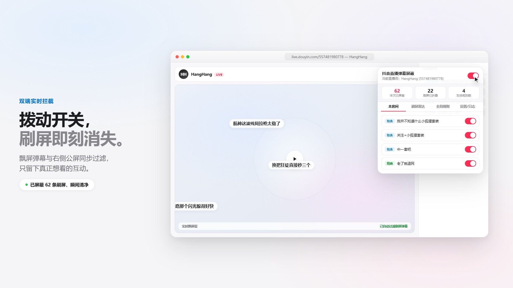
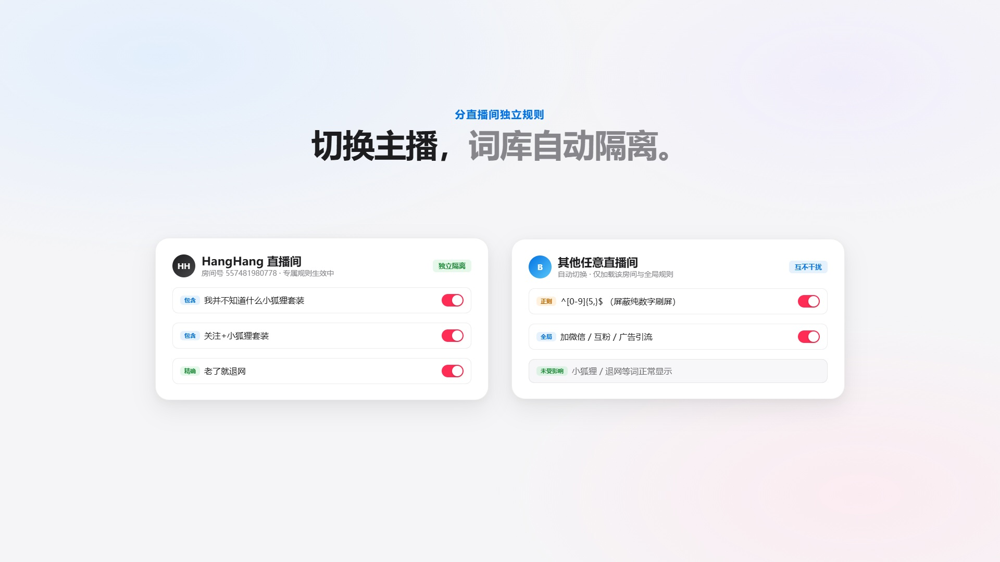
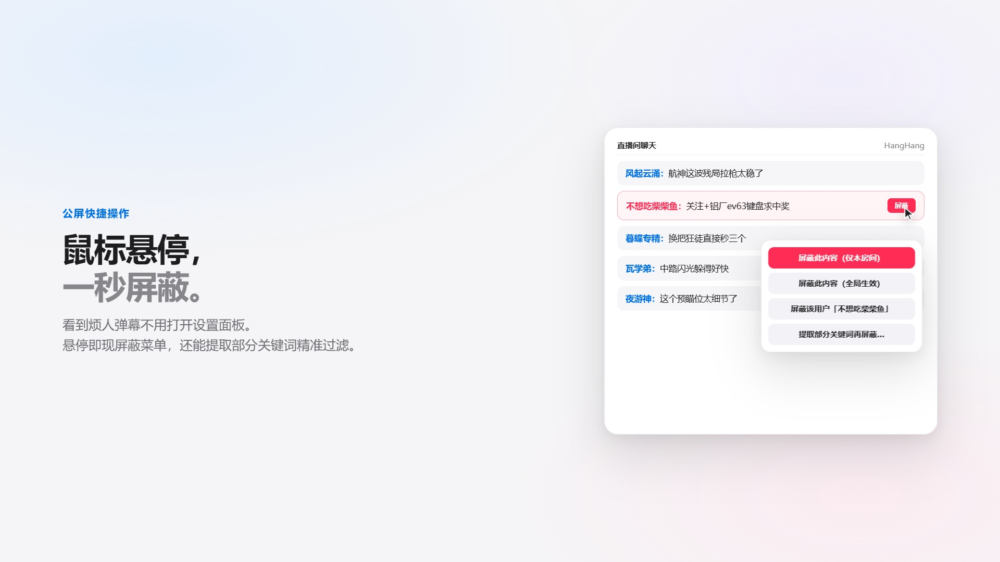
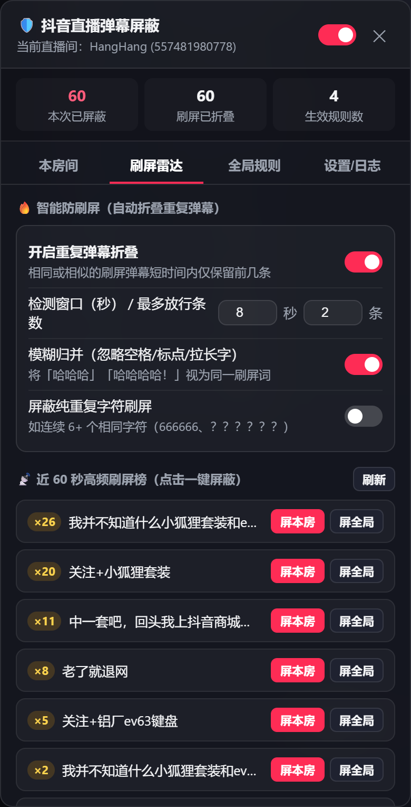

<div align="center">

# 抖音直播弹幕屏蔽助手

**专为抖音网页版直播打造的轻量化弹幕过滤工具 — 按直播间独立隔离刷屏梗，把清净还给直播间。**

[](https://github.com/sky271801/douyin-live-danmaku-blocker)
[](./LICENSE)
[](https://raw.githubusercontent.com/sky271801/douyin-live-danmaku-blocker/main/userscript/douyin-live-danmaku-blocker.user.js)
[](./extension)

同时提供 **油猴脚本（Tampermonkey / Violentmonkey）** 与 **Chrome / Edge 浏览器扩展（免装油猴）** 两种形态，核心引擎 100% 一致，纯本地运行，不收集、不上传任何数据。

[一键安装油猴脚本](https://raw.githubusercontent.com/sky271801/douyin-live-danmaku-blocker/main/userscript/douyin-live-danmaku-blocker.user.js) · [安装浏览器扩展](#方式二chrome--edge-浏览器扩展免装油猴) · [核心功能](#核心功能) · [常见问题](#常见问题)

</div>

---

## 为什么做这个工具？

看抖音网页版直播（`live.douyin.com` / `www.douyin.com/follow/live/...`）时，很多热门直播间总会出现大量**主播专属刷屏梗、抽奖复读口令或广告弹幕**，铺满整个视频画面和右侧聊天室，但抖音网页端本身并没有提供自定义关键词屏蔽功能。

**抖音直播弹幕屏蔽助手** 通过**分直播间独立规则 + 实时刷屏雷达 + 智能复读折叠 + DOM / Canvas / Worker 全链路拦截**，让你只屏蔽不想看的刷屏，不影响正常互动和其他直播间。

---

## 效果预览

| 开关一拨，飘屏与公屏同步清净 | 按直播间独立隔离，切房自动切换 |
| :---: | :---: |
|  |  |

| 公屏鼠标悬停，一秒快捷屏蔽 | 近 60 秒高频刷屏雷达实机界面 |
| :---: | :---: |
|  |  |

---

## 核心功能

| 功能模块 | 说明 |
| :--- | :--- |
| **分直播间独立规则** | 自动识别当前直播间 ID 与主播名称（同时兼容 `live.douyin.com/<房间号>` 与 `www.douyin.com/follow/live/<房间号>?anchor_id=...`），同一主播的专属屏蔽词仅在该房间生效，切房自动隔离，绝不误伤其他直播间。 |
| **全局通用规则** | 针对广告引流、通用无意义复读设置全局规则，对所有抖音直播间生效。 |
| **60 秒实时刷屏雷达** | 自动统计近 60 秒内刷屏频率最高的弹幕热词榜，无需手动打字，点一下 **「屏本房」** 或 **「屏全局」** 即可封杀。 |
| **智能重复弹幕折叠** | 遇到突发复读刷屏潮，自动在滑动时间窗口内仅放行前几条，其余折叠；支持模糊归并空格、标点与拉长字（如 `哈哈哈哈！` 与 `哈哈哈哈哈`），并可选屏蔽纯重复字符（如 `666666`）。 |
| **4 种精准匹配模式** | 支持 `包含匹配`、`精确匹配`、`正则表达式`、`指定用户`（本地静默，不占用官方黑名单名额），自动清洗刷屏机器人常用的零宽隐形字符。 |
| **公屏悬停一键屏蔽** | 鼠标移到右侧公屏任意弹幕上自动浮现「屏蔽」按钮，可一键屏蔽本房、全局、屏蔽该用户或提取部分关键词再屏蔽。 |
| **DOM + Canvas + Worker 全链路拦截** | 同时覆盖右侧公屏聊天室（React 安全 CSS 隐藏，不删节点防崩溃）与视频画面飘屏弹幕（兼容 `xg-danmu` DOM 节点、Canvas 2D / `CanvasDanmakuPlugin` / 离屏雪碧图缓存及 `Worker` / `MessagePort` 消息拦截）。 |
| **系统消息净化（可选）** | 按需分别屏蔽「来了 / 加入直播间」「送出礼物」「关注了主播」「为主播点赞了」等公屏系统刷屏。 |
| **全屏支持与防误杀** | 全屏看直播时按 **`Alt + B`** 随时呼出/收起管理面板；内置最近拦截日志，误杀可一键撤销对应规则；支持配置 JSON 导入导出备份与自定义 CSS 选择器兜底。 |

---

## 快速安装

### 方式一：油猴脚本（Tampermonkey / Violentmonkey）

1. 确保浏览器已安装 [Tampermonkey（篡改猴）](https://www.tampermonkey.net/) 或 [Violentmonkey（暴力猴）](https://violentmonkey.github.io/) 扩展。
2. 点击下方链接即可触发油猴**一键安装**（后续支持自动检测更新）：
   - 👉 **[点击一键安装：douyin-live-danmaku-blocker.user.js](https://raw.githubusercontent.com/sky271801/douyin-live-danmaku-blocker/main/userscript/douyin-live-danmaku-blocker.user.js)**
3. （备选手动安装）打开仓库中的 [`userscript/douyin-live-danmaku-blocker.user.js`](./userscript/douyin-live-danmaku-blocker.user.js)，复制全部内容 -> 在 Tampermonkey 中点击「添加新脚本」-> 粘贴并 `Ctrl + S` 保存。
4. 打开任意抖音网页版直播间，右下角会出现可拖动的 **「弹幕屏蔽」** 悬浮按钮（也可按 `Alt + B` 呼出）。

> **提示**：Chrome / Edge 新版本使用 Tampermonkey 时，如脚本未运行，请确认已在浏览器扩展管理页开启「开发者模式」或允许运行用户脚本。

---

### 方式二：Chrome / Edge 浏览器扩展（免装油猴）

如果你不想安装油猴，可以直接以浏览器扩展方式加载：

1. 点击本仓库右上角 **`Code` -> `Download ZIP`** 下载压缩包并解压（或使用 `git clone`）。
2. 在浏览器地址栏打开扩展管理页：
   - Chrome：`chrome://extensions/`
   - Edge：`edge://extensions/`
3. 打开 **「开发者模式」** 开关。
4. 点击 **「加载已解压的扩展程序」**（Edge 为「加载解压缩的扩展」），选择解压目录中的 **`extension`** 文件夹即可完成安装。
5. 打开抖音网页版直播，既可使用页面内悬浮面板，也可点击浏览器右上角工具栏图标进行快速开关与添加规则。

---

## 项目结构

```text
douyin-live-danmaku-blocker/
├── extension/                    # Chrome / Edge Manifest V3 浏览器扩展
│   ├── manifest.json             # 扩展清单（MAIN world + content script）
│   ├── icons/                    # 16 / 48 / 128 PNG 图标
│   └── src/
│       ├── filter-engine.js      # 核心过滤引擎（规则匹配、防刷屏、刷屏雷达）
│       ├── page-canvas-hook.js   # MAIN world Canvas / OffscreenCanvas / Worker 拦截钩子
│       ├── content.js            # DOM 监听、React 安全隐藏、SPA 切房、悬浮面板与快捷屏蔽
│       ├── content.css           # 页面内面板样式
│       └── popup.{html,css,js}   # 浏览器工具栏快捷弹窗
├── userscript/
│   └── douyin-live-danmaku-blocker.user.js  # 由构建脚本自动打包的单文件油猴脚本
├── scripts/
│   └── build.js                  # 零依赖图标生成与油猴脚本打包脚本
├── tests/
│   └── filter-engine.test.js     # Node.js 内置测试套件（11 项核心用例）
└── docs/images/                  # README 展示图
```

---

## 本地开发与测试

本项目无任何第三方 npm 依赖，只需安装 Node.js（推荐 Node 18+）：

```bash
# 克隆仓库
git clone https://github.com/sky271801/douyin-live-danmaku-blocker.git
cd douyin-live-danmaku-blocker

# 修改 extension/src/ 后重新生成图标并打包油猴脚本
node scripts/build.js

# 运行全部单元测试
node --test tests/filter-engine.test.js
```

---

## 常见问题

<details>
<summary><b>1. 支持哪些抖音直播网址？</b></summary>

同时支持独立直播页 `https://live.douyin.com/房间号` 和主站关注直播页 `https://www.douyin.com/follow/live/房间号?anchor_id=...`，且同一主播在两个入口下自动共享同一份房间规则。
</details>

<details>
<summary><b>2. 如果以后抖音网页版改版导致部分弹幕拦截失效怎么办？</b></summary>

打开脚本面板 -> 切换到 **「设置/日志」** -> 滚动到底部查看 **页面检测状态**（可直观看到飘屏容器、公屏消息及 Canvas Hook 统计）。如果抖音更换了 DOM 类名，无需改代码，直接在「自定义 CSS 选择器」中填入新选择器保存即可，或直接提 Issue 反馈。
</details>

<details>
<summary><b>3. 会不会上传我的浏览记录或抖音账号信息？</b></summary>

**完全不会。** 本工具所有匹配、统计与配置存储均在你的浏览器本地完成（`chrome.storage.local` / `GM_setValue`），不发起任何外部网络请求，代码 100% 开源透明。
</details>

---

## 开源协议

基于 [MIT License](./LICENSE) 开源。如果这个工具帮你在看直播时找回了清净，欢迎点个 **Star** 支持！
